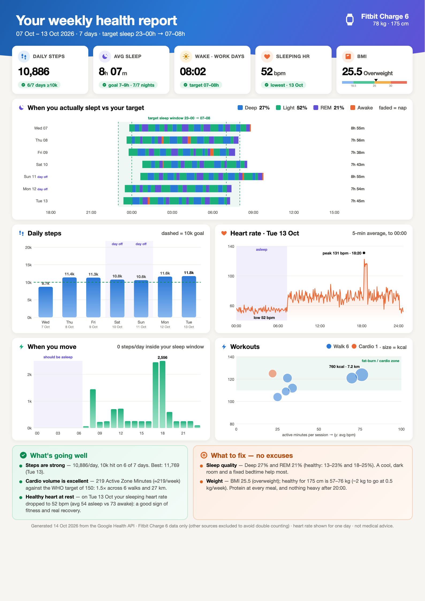
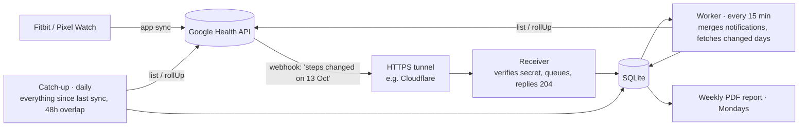

<div align="center">

# google-health-sync

**Own your Fitbit & Pixel Watch data.** Self-hosted sync of the [Google Health API](https://developers.google.com/health) into a local SQLite database, with real-time webhooks and a weekly one-page PDF report.

[](https://github.com/nadeemcite/google-health-sync/actions/workflows/ci.yml)


[](LICENSE)



<sub>Sample report, generated from synthetic data with <code>scripts/demo_data.py</code>.</sub>

</div>

---

## Features

- **Your data, on your hardware.** Steps, sleep stages, workouts, heart rate, resting HR, HRV, weight and body fat in one SQLite file you can query.
- **Near real-time.** Google pushes webhook notifications when new data syncs from your watch, and only the changed days are fetched.
- **Survives downtime.** A daily catch-up with a 48-hour overlap fills any gaps after power cuts or reboots. Google also holds undelivered webhooks for 7 days.
- **Light on bandwidth and storage.** Raw heart rate (~35,000 samples a day) is stored as 5-minute rollups (288 rows a day). Phone and third-party watch data are filtered out so steps aren't double counted. A month of data is about 5 MB.
- **Weekly PDF report.** Sleep timing against your target window, daily steps, a heart-rate day, movement by hour and workouts, plus plain-language "going well" and "what to fix" sections. It adapts to night shifts and days off.
- **Runs anywhere.** A single Docker container for amd64 and arm64 (Raspberry Pi 4/5, Mac mini, NAS), or plain Python with systemd.
- **Alerts.** Optional [ntfy](https://ntfy.sh) push notifications when a sync fails, and a dead-man's-switch ping so you know when the device itself is down.

## How it works



| Job | When | What it fetches |
|---|---|---|
| Webhook receiver | on every notification | nothing; it only queues the notification and replies immediately |
| Worker | every 15 minutes | only the date ranges named in queued notifications, merged per data type |
| Catch-up | daily at `CATCHUP_HOUR`, or at startup if more than 26h have passed | everything since the last sync, re-fetching the last 48h |
| Report | Mondays, an hour after the catch-up | nothing; it reads SQLite and writes `reports/fitbit-report-<date>.pdf` |

Webhooks are optional. Without a public URL it runs in polling-only mode (the daily catch-up, plus `POLL_EVERY_HOURS` if you set it).

## Requirements

- A Fitbit or Pixel Watch synced to the **Google Health app** (formerly the Fitbit app).
- A Google Cloud project with access to the **Google Health API**.
  > ⚠️ At the time of writing, Google says it is *"not onboarding new projects at this time"* for the Google Health API. Check the [Google Health API docs](https://developers.google.com/health) before you start.
- An always-on machine: Raspberry Pi 4/5 (64-bit OS, 2 GB+ RAM recommended), a mini PC, a NAS or a Mac, with **Docker**, or Python 3.12 and [uv](https://docs.astral.sh/uv/).
- Optional: a public HTTPS hostname for webhooks, e.g. a free [Cloudflare Tunnel](https://developers.cloudflare.com/cloudflare-one/connections/connect-networks/).

## Setup

### 1. Google Cloud

1. Create a project in the [Google Cloud Console](https://console.cloud.google.com) and enable **Google Health API** (`health.googleapis.com`).
2. **Google Auth Platform → Audience:** set the user type to *External*.
   - Add yourself as a test user to get started.
   - Then click **Publish app**. While an app is in *Testing*, Google expires refresh tokens after **7 days**, which breaks unattended syncing. A personal app can stay *unverified*: you'll see a "Google hasn't verified this app" screen once when signing in, and you don't need to submit it for review.
3. **Data Access:** add these scopes:
   ```
   https://www.googleapis.com/auth/googlehealth.activity_and_fitness.readonly
   https://www.googleapis.com/auth/googlehealth.health_metrics_and_measurements.readonly
   https://www.googleapis.com/auth/googlehealth.sleep.readonly
   https://www.googleapis.com/auth/googlehealth.profile.readonly
   ```
4. **Clients → Create client → Desktop app.** Copy the client ID and secret.
   - A Desktop client needs no redirect URI.
   - If you use a *Web* client instead, add `http://localhost:8080` as an authorized redirect URI.
5. Note your **project number** (Cloud Console dashboard). You only need it for webhooks.

### 2. Configure

```sh
git clone https://github.com/nadeemcite/google-health-sync.git
cd google-health-sync
cp .env.example .env
```

Fill in `.env`. Every setting is documented in [`.env.example`](.env.example). The important ones:

| Variable | Example | Purpose |
|---|---|---|
| `GOOGLE_CLIENT_ID`, `GOOGLE_CLIENT_SECRET` | | Your OAuth client from step 1 |
| `WEIGHT_KG`, `HEIGHT_CM` | `78`, `175` | BMI in the report |
| `TZ` | `Europe/London` | Scheduler timezone |
| `TARGET_BEDTIME`, `TARGET_WAKE` | `23-00`, `07-08` | Your target sleep window (hour ranges; overnight is fine) |
| `WORK_HOURS` | `09-17` or `18-03` | Optional; enables shift-aware advice |
| `CATCHUP_HOUR` | `10` | Daily sync hour, about 2h after you usually wake |

### 3. Sign in once

Sign-in needs a browser, so do it on your laptop even if the service will run on a headless Pi:

```sh
uv run healthsync.py auth    # opens Google sign-in, writes credentials/token.json
uv run healthsync.py catchup # optional: test it; backfills 30 days into data/health.db
```

Then copy `credentials/token.json` to the same path on your server. Copying `data/health.db` too skips the backfill there.

### 4a. Run with Docker (recommended)

Docker works on Raspberry Pi OS 64-bit, Linux, macOS and NAS boxes:

```sh
# Raspberry Pi: install Docker first:  curl -fsSL https://get.docker.com | sh
docker compose up -d --build
docker compose logs -f
```

`restart: unless-stopped` brings it back after reboots and power cuts. The first catch-up runs straight away.

### 4b. Run without Docker (Raspberry Pi / systemd)

```sh
sudo apt install -y chromium fonts-inter     # for the PDF report
curl -LsSf https://astral.sh/uv/install.sh | sh
uv sync
sudo cp deploy/healthsync.service /etc/systemd/system/   # edit User/WorkingDirectory first
sudo systemctl enable --now healthsync
journalctl -u healthsync -f
```

### 5. Webhooks (optional)

1. Expose the service on a public HTTPS hostname. With a Cloudflare Tunnel, add a public hostname such as `health.example.com` pointing to `http://localhost:18787`.
2. Set `GOOGLE_PROJECT_NUMBER`, `WEBHOOK_URL` and `WEBHOOK_SECRET` (`openssl rand -hex 32`) in `.env`, then restart.
3. Register the subscriber once. This needs [`gcloud`](https://cloud.google.com/sdk/docs/install), logged in as a project owner:
   ```sh
   gcloud auth login
   uv run healthsync.py subscribe
   ```
   Google verifies the endpoint straight away: it must return `201` with the secret and `401` without it. Make sure the service is reachable first.

## Usage

```sh
uv run healthsync.py catchup                 # sync now
uv run healthsync.py worker                  # process queued webhook notifications
uv run report.py --weight 78 --height 175    # report for the last 7 days
uv run report.py --weight 78 --height 175 --end 2026-10-06
```

Try the report without a Google account:

```sh
uv run scripts/demo_data.py
HEALTH_DB=demo/health.db REPORT_DIR=demo uv run report.py --weight 78 --height 175
```

Query your data directly:

```sh
sqlite3 data/health.db "SELECT civil_date, json_extract(payload, '$.dailyRestingHeartRate.beatsPerMinute')
                        FROM data_points WHERE data_type = 'daily-resting-heart-rate' ORDER BY civil_date DESC LIMIT 7"
```

| Table | Contents |
|---|---|
| `data_points` | One row per API data point (`steps`, `sleep`, `exercise`, `daily-resting-heart-rate`, `daily-heart-rate-variability`, `weight`, `body-fat`), raw JSON in `payload` |
| `heart_rate_5min` | Heart-rate rollups: avg / min / max per 5-minute window |
| `webhook_queue` | Received notifications and when they were processed |
| `sync_state` | Per-type sync watermarks and job timestamps |

## Privacy

- Everything stays on your machine. The only network calls go to Google's APIs and, if you configure them, ntfy and your heartbeat URL.
- `.env`, `credentials/`, `data/` and `reports/` are git-ignored. Never commit them.
- Webhook payloads contain no health values, only "data type X changed in this time range". The receiver rejects any request without your shared secret.

## Troubleshooting

| Symptom | Fix |
|---|---|
| `redirect_uri_mismatch` on sign-in | Use a *Desktop* OAuth client, or add `http://localhost:8080` (exact match, no trailing slash) to your Web client |
| Sync stops after ~7 days with `invalid_grant` | Your OAuth app is in *Testing*. Publish it, then run `healthsync.py auth` again |
| `ACCOUNT_NOT_LINKED` | Open the Google Health app on your phone and finish setting up your profile |
| `subscribe` fails with `FAILED_PRECONDITION` | Google couldn't verify the endpoint. Check the tunnel and `WEBHOOK_SECRET`, and that `curl https://<host>/healthz` returns `ok` |
| Report says "Not enough data" | It needs at least one day of steps and one night of sleep in the last 7 days |

## Disclaimer

Not affiliated with Google or Fitbit. The report gives general wellness information, not medical advice.

## License

[MIT](LICENSE)
