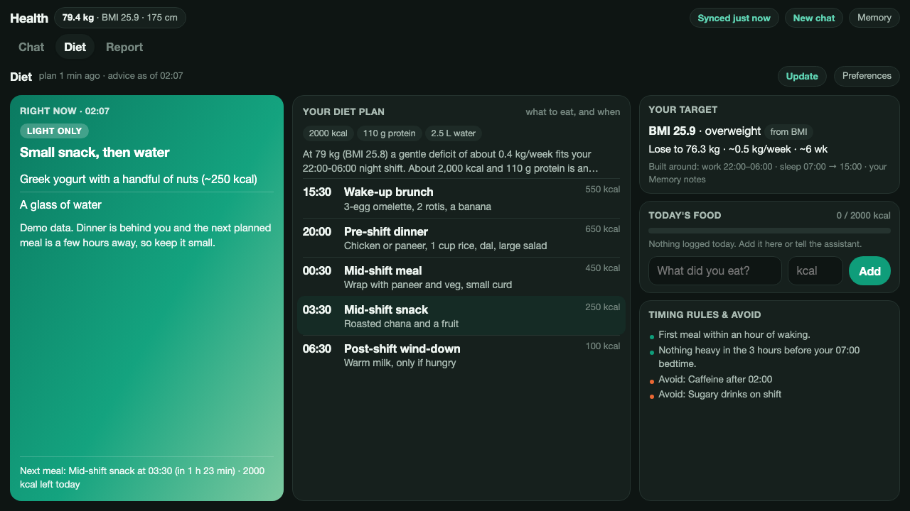
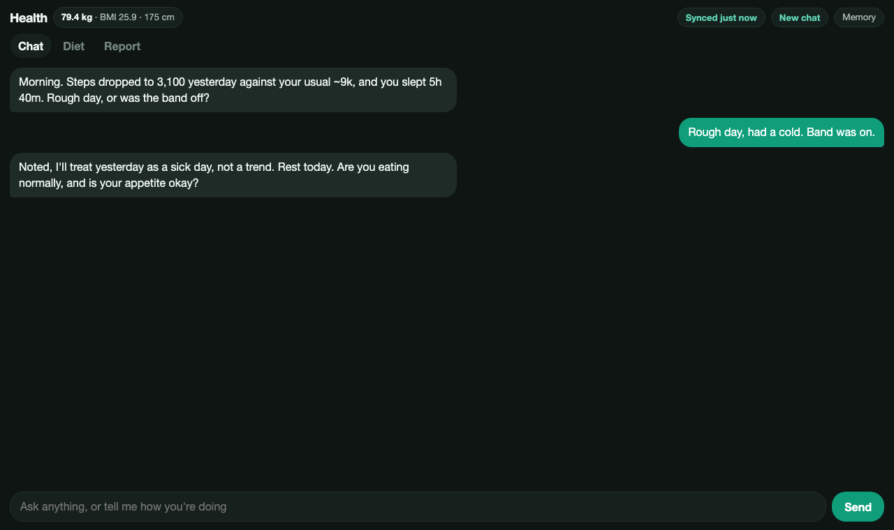
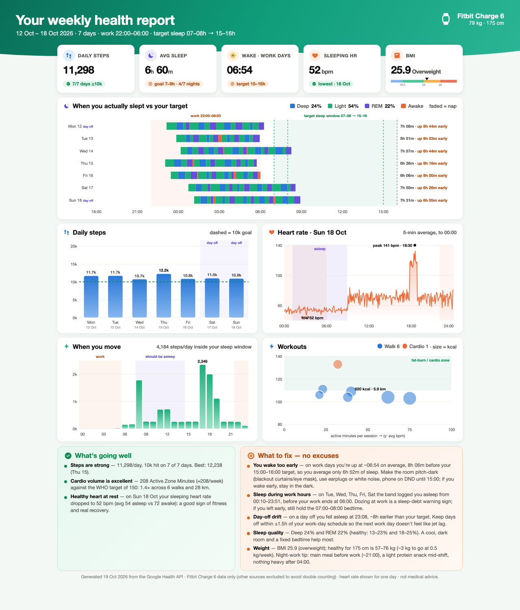
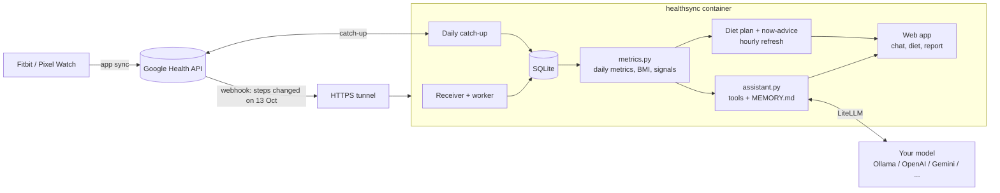

<div align="center">


# google-health-sync

**A personal health assistant that knows your data.**<br>
Self-hosted. Syncs your Fitbit / Pixel Watch data from the [Google Health API](https://developers.google.com/health) into SQLite, then puts a chat assistant, a diet planner and a weekly report on top of it. It remembers what you tell it.

[](https://github.com/nadeemcite/google-health-sync/actions/workflows/ci.yml)


[](LICENSE)



<sub>Screenshots use synthetic data from <code>scripts/demo_data.py</code>. No real health data is in this repository.</sub>

</div>

---

## What it does

Open the app and it behaves like a health expert who already knows you.

| | |
|---|---|
| **Opens the conversation itself** | "Steps dropped to 3,100 yesterday against your usual 9k and you slept 5h 40m. Rough day, or was the band off?" It checks your data first, then asks about the cause. |
| **Remembers you** | After every exchange it rewrites a plain-text `MEMORY.md` (injuries, food habits, schedule, reasons for off days). Next time it already knows, and it stops asking what you already answered. |
| **Diet tab, one screen** | *What to do right now* (or "Avoid eating, have water" in your sleep window), your plan with meal times, and your target. No goal weight needed: it derives one from your BMI. |
| **Built around your day** | Night shift? Meals, caffeine cut-off and "heavy food" rules follow *your* wake, work and sleep hours, plus whatever you told it. |
| **Weight & food logging** | Weigh-ins from the Google Health app sync in on their own. Or log by hand, or just tell the assistant "I weigh 79.5 today". |
| **Weekly report** | Sleep timing against your target window, steps, heart rate, workouts, and plain-language "what's going well / what to fix". As a web page or PDF. |
| **Always fresh** | Google pushes a webhook when your watch syncs. A daily catch-up closes gaps after power cuts. A **Sync** button forces it. |
| **Bring your own model** | [LiteLLM](https://docs.litellm.ai) underneath: Ollama Cloud, a local Ollama, OpenAI, Gemini, and more, by changing one setting. |

<table>
<tr>
<td width="50%"></td>
<td width="50%"></td>
</tr>
<tr>
<td align="center"><sub>The assistant opens with something it noticed</sub></td>
<td align="center"><sub>The weekly report, as a web page (also a PDF)</sub></td>
</tr>
</table>

## Can I try it?

**Not on my instance, by design.** It reads one person's health data (sleep, heart rate, weight), so nothing is hosted publicly and there is no shared login. The code is open instead: you run your own copy, with **your own Google Cloud project, your own watch data and your own model key**. Nothing of mine is involved.

- **Full walkthrough:** [docs/TUTORIAL.md](docs/TUTORIAL.md) (about 45 minutes, most of it Google Cloud setup).
- **Two-minute look without a Google account:** run it on synthetic data, see [Try it with demo data](#try-it-with-demo-data).

## Quick start

You need Docker, a Google Cloud project with the Google Health API enabled, and an LLM key (or a local Ollama).

```sh
git clone https://github.com/nadeemcite/google-health-sync.git
cd google-health-sync
cp .env.example .env              # fill in Google client, routine, model (see the tutorial)
uv run healthsync.py auth         # one-time Google sign-in in your browser
docker compose up -d --build
open http://localhost:18787
```

Each step in detail, including the Google Cloud clicks: **[docs/TUTORIAL.md](docs/TUTORIAL.md)**.

## Try it with demo data

No Google account, no watch. The assistant's replies need a model, but everything else (diet tab, report, logging, charts) works from seeded data:

```sh
uv sync
export HEALTH_DB=demo/health.db MEMORY_FILE=demo/MEMORY.md REPORT_DIR=demo HEIGHT_CM=175 \
       WORK_HOURS=22-06 TARGET_BEDTIME=07-08 TARGET_WAKE=15-16
uv run scripts/demo_data.py          # a week of synthetic sleep, steps, heart rate, workouts
uv run scripts/seed_demo_app.py      # weight, a chat, a diet plan, food log
PORT=18996 uv run healthsync.py serve
open http://localhost:18996
```

To also chat, add `ASSISTANT_MODEL` and its key (see [Choose a model](docs/TUTORIAL.md#4-choose-a-model)).

## How it works



The model never sees the database directly. It gets a handful of **tools** (`get_daily_metrics`, `get_weight_history`, `log_weight`, `log_food`, `get_food_log`, `set_profile`) and is told never to state a fact about your body that it did not read from a tool or from `MEMORY.md`. A `null` from the band means "recorded nothing", and the assistant asks instead of assuming you were inactive.

Design notes, data model and trade-offs: **[docs/ARCHITECTURE.md](docs/ARCHITECTURE.md)**.

## Tech

Python 3.12 standard-library HTTP server · SQLite (WAL) · [LiteLLM](https://docs.litellm.ai) · a single static HTML page with vanilla JS (no build step) · headless Chromium for the PDF · Docker (amd64 + arm64) · GitHub Actions CI with tests that need no network or model.

## Configuration

Everything is an environment variable in `.env`; every one is documented in [`.env.example`](.env.example) and tabulated in [docs/CONFIGURATION.md](docs/CONFIGURATION.md). The ones you will touch first:

| Variable | Example | Purpose |
|---|---|---|
| `GOOGLE_CLIENT_ID`, `GOOGLE_CLIENT_SECRET` | | Your OAuth client |
| `ASSISTANT_MODEL` | `ollama_chat/glm-5.3-flash` | Any [LiteLLM](https://docs.litellm.ai/docs/providers) `provider/model` |
| `OLLAMA_API_KEY` (or the provider's key) | | Key for the model above |
| `WORK_HOURS`, `TARGET_BEDTIME`, `TARGET_WAKE` | `22-06`, `07-08`, `15-16` | Your day, as hour ranges (overnight is fine) |
| `TZ` | `Asia/Kolkata` | Scheduler timezone |

## Privacy and security

- **Your data stays on your machine, with one exception:** when you use the assistant, your messages, `MEMORY.md` and whatever the assistant looks up (daily steps, sleep, weights) go to the model provider you configured. A local Ollama keeps everything on your network.
- `.env`, `credentials/`, `data/` and `reports/` are git-ignored. **Never commit them.**
- The web app has **no login by default**. Put it behind [Cloudflare Access](https://developers.cloudflare.com/cloudflare-one/applications/) or set `REPORT_BASIC_AUTH=true`. Anyone who can reach it can read your data, log weights and spend your model credit.
- `/webhook` has its own shared secret and carries no health values, only "data type X changed in this range".
- POST endpoints require `Content-Type: application/json`, which a cross-site form cannot send.
- Not medical advice. The assistant is told to send you to a clinician for anything that sounds serious, but it is a language model working from wearable data.

## Limits (honest ones)

- **Single user.** One person's data, one conversation history.
- **Google Health API access is Google's to control.** Setup is self-serve through Google Cloud (create a project, enable the API, add yourself as a test user). Unverified apps are limited to 100 users, and all scopes are classified Restricted, so a public launch needs Google's verification and a security review. Check the [Google Health API docs](https://developers.google.com/health) for current availability.
- **Calorie numbers are estimates** from weight, height and activity. Age and sex are not used.
- **Model quality varies.** Small or "flash" models call tools less reliably and may be slow when they reason. If the assistant makes claims without checking the data, use a larger model.
- **The assistant only knows food you log or mention.**

## Development

```sh
uv sync
uv run python -m unittest discover -s tests -v    # 14 tests, no network, no model, no Google
uv run scripts/demo_data.py && HEALTH_DB=demo/health.db uv run report.py --weight 78 --height 175
```

| File | Role |
|---|---|
| `healthsync.py` | Sync jobs, scheduler, webhook receiver, HTTP handler |
| `fetch.py` | Google OAuth and API field mapping |
| `metrics.py` | Read-side: daily metrics, weight, BMI, diet target, signals |
| `assistant.py` | LiteLLM calls, tools, `MEMORY.md`, diet plan and now-advice |
| `webapp.py` | Routes for the page and JSON API |
| `report.py` | The weekly report (HTML + PDF) |
| `web/index.html` | The whole frontend |

## License

[MIT](LICENSE)
