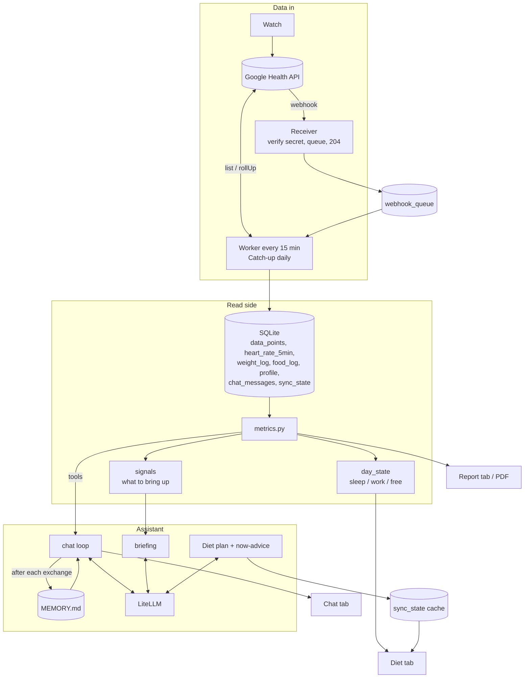

# Architecture

One Python process, one SQLite file, one static HTML page. The interesting parts are how the assistant is kept honest about your data, and how the Diet tab is made fast and always-correct.

## Data in

- **Webhooks** carry no health values, only "data type X changed in this range". The receiver verifies a shared secret, queues the message and replies `204` immediately. A worker later fetches just those date ranges, coalescing many notifications into one fetch per type.
- **Catch-up** runs daily and on startup if more than 26 h passed (power cuts). It re-fetches the last 48 h because Google revises sleep and daily summaries after the fact.
- **Replace-by-range writes.** Syncing a range deletes and re-inserts it, so deletions in the Google app propagate.
- **Heart rate** is about 35,000 samples a day, so only 5-minute rollups (288 rows/day) are stored.
- **One source of truth for steps/sleep:** phone and third-party-watch data are filtered out to avoid double counting.

## The assistant

### Grounding: tools, not recall
The model gets six tools: `get_daily_metrics`, `get_weight_history`, `get_food_log` (read) and `log_weight`, `log_food`, `set_profile` (write). The system prompt forbids stating facts about activity, sleep or weight that were not read from a tool or from memory, and defines `null` as "the band recorded nothing", which is different from zero. So "you did not walk yesterday" becomes a question ("was the band on?") instead of an accusation.

### Signals decide *what to say first*
`metrics.signals()` is plain code, not a model. It produces facts plus the question they raise: no steps yesterday, steps below 40% of the typical day, a weight trend flat or rising against the goal over 4 weeks, a stale weigh-in, short sleep, a stale sync. On first open each day, the model is asked to open the conversation about the most important one. Deciding *what is worth raising* in deterministic code and only *wording it* with the model keeps the behaviour testable and cheap.

### Memory
`data/MEMORY.md` is a human-readable file. After each exchange a second, low-effort model call receives the current file plus the exchange and returns the whole updated file. Guards: it keeps the headings, must stay under about 12k characters, must not shrink below 40% of its previous size, writes atomically, and keeps a `.prev` copy. Wearable numbers are deliberately *not* stored in it; those stay in the database and only the conclusions are kept. The file is injected into every system prompt, and its "Routine & lifestyle" section also feeds the diet plan.

### Sessions
"New chat" bumps a session counter. Old chats stay in SQLite; knowledge carries over through `MEMORY.md`, not through replaying history.

## The Diet tab

| Piece | How |
|---|---|
| **Target** | `diet_target()` derives direction and goal from BMI when no goal weight is set: overweight → lose to the top of the healthy range at 0.5 kg/week, underweight → gain, healthy → maintain. A goal weight overrides it |
| **Plan** | One model call returns strict JSON (kcal, protein, water, meals with `HH:MM`, timing rules). It is built from the BMI target, `WORK_HOURS` / `TARGET_BEDTIME` / `TARGET_WAKE`, preferences, the last 7 days of food, and the memory's lifestyle section. Parsed defensively, retried once, times normalised |
| **Right now** | In the sleep window the answer is **computed in code** ("Avoid eating. Have water."), with no model call, so it is instant and cannot be wrong. Otherwise a model call chooses `eat` / `light` / `avoid` from the plan, the clock, the minutes to bed and what was already eaten |
| **Freshness** | A background thread refreshes about hourly. The page reads the cache. Opening the tab re-checks if the advice is older than 65 min or the day state changed. The Update button forces a rebuild |
| **When does the plan rebuild?** | Only when something it depends on changes: a fingerprint of BMI band, routine, preferences and the lifestyle notes, or after 7 days. Not on every chat message |

Long jobs (about a minute for a plan) run in a background thread and the page polls, because a tunnel such as Cloudflare cuts requests off around 100 s.

## Design decisions worth knowing

- **Stdlib `http.server`, no framework.** One user, a handful of routes. Fewer moving parts to run on a Raspberry Pi.
- **No frontend build.** `web/index.html` is the whole UI. There is nothing to compile, and the page works offline-first from cached API state.
- **LiteLLM behind one function** (`assistant.llm`). Provider quirks (reasoning budgets, dropped unsupported params) live in one place, and tests replace that single seam with a fake.
- **Reasoning models need headroom.** A model that "thinks" can spend its whole token budget and return an empty answer; `llm()` therefore sets `reasoning_effort` and a floor on `max_tokens`.
- **Optional auth, secure by default for webhooks.** `/webhook` always requires its secret; the rest of the app is open unless `REPORT_BASIC_AUTH` is on, because the intended deployment puts it behind Cloudflare Access.
- **CSRF** is handled by requiring `Content-Type: application/json` on every POST, which a cross-site HTML form cannot send.
- **Only an allowlist of static files** is served from `web/` (the icons). Request paths are never joined onto the filesystem.

## Testing

`tests/test_app.py` (14 tests) needs no network, Google account or model. It covers the BMI-to-target logic, night-shift window wrapping past midnight, the weight trend, every HTTP route including auth, CSRF and path traversal, and the assistant's full tool loop and memory rewrite against a faked model. CI also builds the report from synthetic data and builds the Docker image for amd64 and arm64.

## Known limits

Single user. Calorie estimates ignore age and sex. The assistant knows only the food you log or mention. Model quality varies a lot with size; tool calling is the capability that matters.
